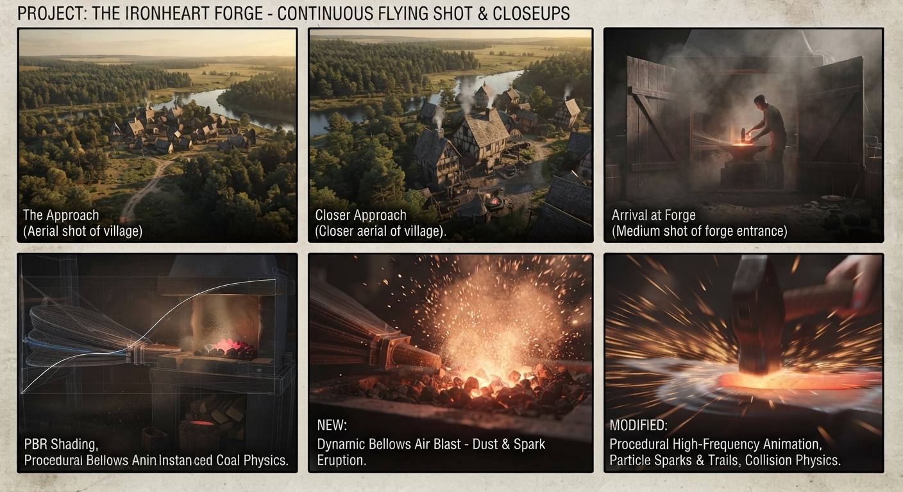

# Description of the final demo scene

## Blacksmith closeup

### Story

Camera flies into doors that open in front of it revealing very dark room full of dust, illuminated only by hot coal, metal and one small window.
Door close behind camera and the blacksmith is pressing onto bellows, closeup of the hot coal sparks, red hot glowing cload in the middle (some kind of space aware shader, with outside impulses)
As bellows blow some coals get blown away (showing away physics simulation)
Then second blacksmith moves prepares to strike red hot metal, vertigo effect slowmotion closeup, sparks fly off the metal as its hit, time goes back to normal and blacksmith shows off different strike techniques (procedural animation)

### Technical

PBR

- Metalic hammer
- Red hot glowing metal

Particle system

- Sparks flying

Bellows animating, dust particles + forge glowing animation

Instanced piecies of coal + physics simulation with high friction (wind as external force)

Hammer hitting animation procedural with different frequencies etc..interlaced with bellows animation

### Maybe

Watter ripples when hammer strikes
Shell textured fur on wall
VOLUMETRIC FOR THE DUST IN THE ROOM

## Storyboard

