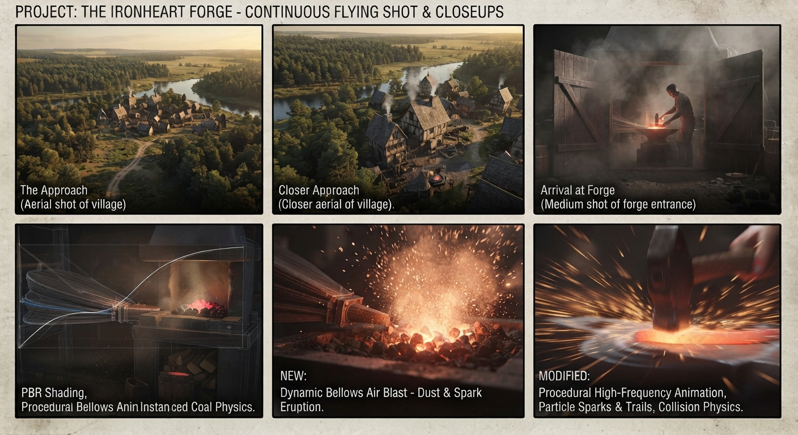

# Description of the final demo scene

The demo is four shots. Shots 1 to 3 are the city on one clock ("Demo scene",
`src/scenes/demo_scene/demo_scene.cpp`), then it cuts to shot 4, the inside of
the smithy, which is its own scene ("Smithy interior",
`src/scenes/smithy/smithy_scene.cpp`), so the city isn't drawn behind the walls.
The cut goes through `Scene::cutTo`, the SceneManager loads the named scene.

| Shot | Scene | Time | What |
|---|---|---|---|
| 1 | Demo scene | 0-82 s | Day flyby: low along the road and over the lake |
| 2 | Demo scene | 82-96 s | Tilt-shift timelapse from high above, day into night |
| 3 | Demo scene | 96-186 s | The same flyby at night, then into the smithy's door |
| 4 | Smithy interior | 0-44 s | Inside the smithy: bellows, coal, anvil |

The flyby's length comes from its path (`FLYBY`: points with the camera's
speed at each, so slower or faster is a matter of those speeds), the rest from
`LAPSE` and `APPROACH` at the top of the demo scene's file; the smithy has
`DOORS_SHUT`, `GUST`, `SLOW_IN`, `SLOW_OUT`, `END`.

## Shot 1: the day flyby

Late morning, the sun stands still: its shadow map is baked (drawn once), one
box over the whole city. The camera flies low (4 to 10 m up), looking along
its path:

- in over the east wheat field and the east village, across the east bridge
  and over the east gate
- down the road to the market square, then south down the main street and
  over the south gate and bridge
- west along the road through the south village and its wheat field, down to
  the river's west arm
- the lake: around the west of the island under the castle, past the ships
  and the north shore's village, to the two ships off the port
- into the port, over the north gate and down the north street to the square,
  in front of the smithy

The path was read off a top-down picture of the city and every point checked
against a height map of everything in it, trees and towers are close
(`tools/flyby/`). The camera looks from where it was a second ago to where it
will be in three: it turns into a bend early and doesn't sway with the path.

The boats and ships ride the water's waves (`Floating`: the height and slope
of the same sum of waves `water.vs` draws, at the boat, every frame), and
roll from side to side a little on their own; their crews and cargo are their
children. The wreck on the rocks stays put.

### To add

- People walking: no mesh animation, only their transforms hop along through
  the city. For now they stay where they stand and each hops a little on the
  spot at random times, 6 to 25 s apart (`Hopping`, on the node with a
  model's instances)
- Birds circling, their wings flapping (a model is still to be found)

## Shot 2: the timelapse into the night

High above the city, narrow 30 deg view, a slow drift while the day goes by at
an even speed, from the late morning to the middle of the night. The sun
crosses the sky along the view direction and the camera drifts across it, so
the shadows don't sweep along with the camera.

### Technical

- Day and night: the sun and moon animators are driven by the demo's clock
  (`seek`), the sky tint follows
- Tilt-shift blur: post-processing pass (to do, post-processing)

### To add

- The people and the birds of shot 1 are still there, and disappear as it
  gets dark
- Lamps (point lights) turning on one by one

## Shot 3: the night flyby

The same path as shot 1, under the moon, then on between the market stalls
and low over the ground beside the people in front of the smithy. The smithy
(the forge building, standing where one House_7_1 of the city was, door toward
the square) opens its doors, the camera flies into the dark doorway (a black
card behind the doors) and the demo cuts to shot 4.

### To add

- The lamps of shot 2, lit

Smoke rises out of the chimneys near the path and the smithy's own (a
particle emitter each, on from half way into the timelapse). The water
reflects the sky with its night tint, so it's dark too.

## Shot 4: Blacksmith closeup

### Story

Camera flies into doors that open in front of it revealing very dark room full of dust, illuminated only by hot coal, metal and one small window.
Door close behind camera and the blacksmith is pressing onto bellows, closeup of the hot coal sparks, red hot glowing cload in the middle (some kind of space aware shader, with outside impulses)
As bellows blow some coals get blown away (showing away physics simulation)
Then second blacksmith moves prepares to strike red hot metal, vertigo effect slowmotion closeup, sparks fly off the metal as its hit, time goes back to normal and blacksmith shows off different strike techniques (procedural animation)

### What's in it

The room is the forge building's shell, furnished with the old-smithy pack
(`tools/export_smithy.py` makes `res/models/SMY_*.glb` and
`src/scenes/smithy/smithy_layout.hpp` from `../old-smithy`) and the props of
the building's own pack (barrels, quench tub, tool rack, workbench...).

- 0-3.5 s: the camera comes in, the doors shut behind it
- 3.5-11 s: the bellows pumping (the lever, rope and bellows body animate)
- 11-18 s: the coal bed, close; at 15 s a big gust throws some coal over the
  tray's low rim, it rolls off the hearth onto the floor
- 21-31 s: the anvil, dolly zoom (vertigo: the camera moves in from 1.4 m to
  0.75 m while the view widens from 30 to 53 deg) in slow motion (0.2x), sparks
  off every hammer blow
- 31-44 s: back to normal speed, pulling back to the whole room

### Technical

- The pack's keyframes (hammer, sword, bellows lever) replayed by the engine's
  Animator, looping every 6.8 s; the bellows body and rope follow the lever
  (not in the pack), the grindstone wheel spins
- Coal: 120 instanced pieces (3 draws), each a physics sphere with high
  friction in the hearth tray; the air of the bellows is a wind field over the
  bed (`physics::Context::windField`), every closing stroke pushes, the gust
  throws
- The fire's heat follows the bellows: forge light intensity, coal glow
  (emissive maps) and ember particles
- Particles: embers off the coal, sparks off every hammer blow (bursts),
  dust in the window's light
- Lights: the fire (point, shadows), the hot metal (point), the window (spot,
  shadows), a dim bounce light so the room isn't black

### To add

- The blacksmiths: the pack has none, the hammer swings on its own for now
- Different strike techniques (procedural animation)
- Red hot glowing cloud over the coal (space aware shader, with outside
  impulses)
- PBR: metallic hammer, red hot glowing metal

### Maybe

Watter ripples when hammer strikes
Shell textured fur on wall
VOLUMETRIC FOR THE DUST IN THE ROOM

## Storyboard

